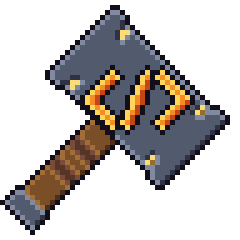
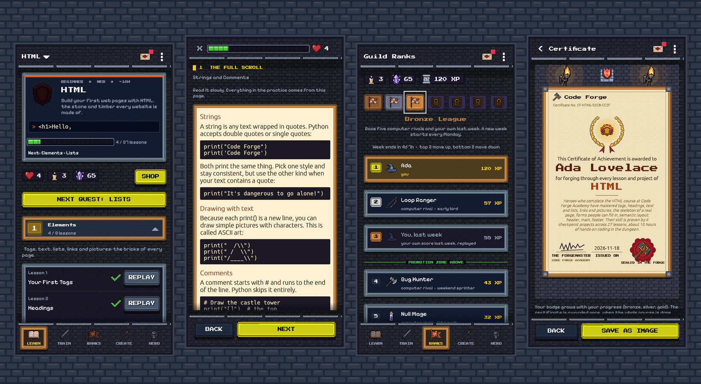
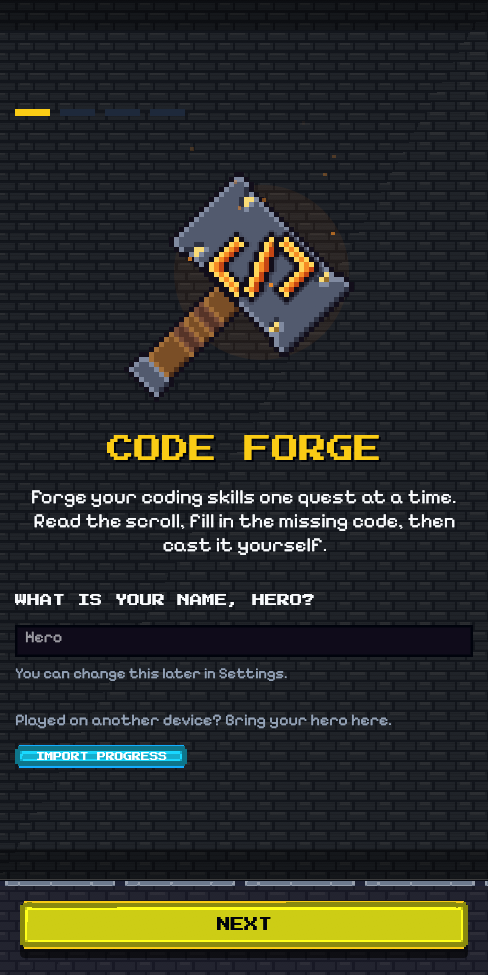
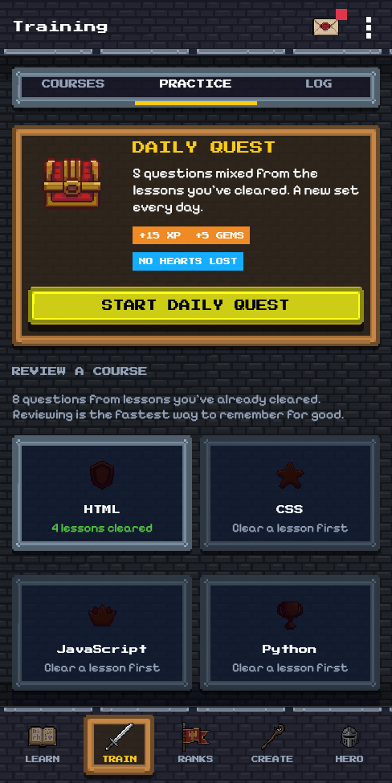
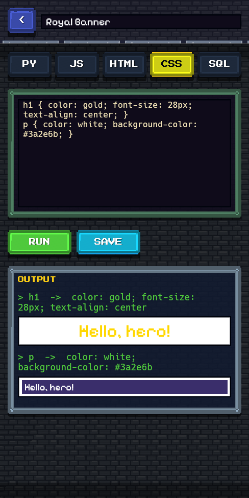
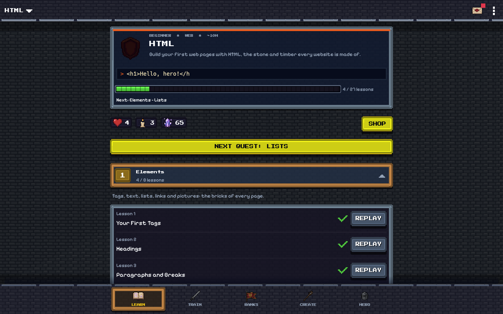

<div align="center">



# Code Forge

**Learn to code in a pixel-art dungeon.**
Read a short scroll, fill in the missing code, then forge it yourself and watch it run.

[](https://github.com/JreyForFun/code-forge/releases/latest)
[](https://github.com/JreyForFun/code-forge/releases)
[](LICENSE)


[**Download**](#-download) · [Features](#-features) · [Screenshots](#-screenshots) · [Build from source](#-build-from-source) · [Contributing](#-contributing)



</div>

## ✨ Why Code Forge?

- 📜 **181 lessons in 5 courses**: HTML, CSS, JavaScript, Python and SQL, written for complete
  beginners in plain language.
- ⚒️ **Your code really runs.** Python and JavaScript execute, HTML and CSS render a live preview,
  and SQL queries a real sample database.
- 🏰 **A game, not a textbook.** XP, levels, hearts, streaks, weekly leagues, a Duel Arena and a
  dungeon full of pixel art and synthesised music.
- 📴 **100% offline, no account, no ads, no tracking.** Your progress stays on your device.
- 💻📱 **Windows and Android**, with progress you can move between them.

## 📥 Download

| Platform | File | How to install |
| --- | --- | --- |
| **Windows 10/11** (64-bit) | [`CodeForge-1.0.0-windows.zip`](https://github.com/JreyForFun/code-forge/releases/latest) | Unzip anywhere and double-click **CodeForge.exe**. Nothing to install. |
| **Android 8.0+** | [`CodeForge-1.0.0-android.apk`](https://github.com/JreyForFun/code-forge/releases/latest) | Open the file on your phone and allow *Install unknown apps* if asked. |

> [!NOTE]
> Windows may say *"Windows protected your PC"* because the app isn't code-signed yet. Click
> **More info → Run anyway**. You can check your download against the SHA-256 checksums on the
> release page (see [SECURITY.md](SECURITY.md)).

## 🎮 Features

<table>
<tr>
<td width="50%" valign="top">

**📚 Learn**
- 5 courses, 181 lessons, every chapter ends with a **checkpoint project**
- Each lesson: picture slides → **The Full Scroll** (a long, plain explanation with examples and
  common mistakes) → a **summary** → 6+ practice steps (quiz, complete the code, type it, code it
  from memory)
- **Course preview** with chapters, time estimate and what you'll learn
- Re-read the notes of any lesson you've cleared

</td>
<td width="50%" valign="top">

**⚔️ Practise**
- **Daily Quest**: 5 mixed questions, once a day
- **Course reviews** built from lessons you've cleared
- **Quick challenges** in all five languages
- **Duel Arena**: beat four computer champions' scores
- **Spell Lab**: write, run and save your own programs

</td>
</tr>
<tr>
<td valign="top">

**🏆 Progress**
- XP, levels, gems, daily streaks and streak savers
- **Weekly leagues**: 7 tiers, five rivals tuned to your pace plus a ghost of your last week
- Course **badges** that grow bronze → silver → gold
- A dungeon-style **certificate** for every finished course, saved as an image

</td>
<td valign="top">

**🎨 Feel**
- Stone-brick dungeon look with an animated forge intro
- Original music for the hub, study, title and battles, all synthesised in code
- Fits every screen, from 320 px phones to tablets and desktops
- Text size, volume sliders and full keyboard control

</td>
</tr>
</table>

<details>
<summary><b>Rules at a glance</b></summary>

| | |
| --- | --- |
| Hearts | 5 max. A wrong answer costs 1. Refill 1 every 5 minutes, 10 gems for a full refill, or 1 free per day |
| XP | First clear: 10 XP (+5 if flawless) and 5 gems. 100 XP per level. Repeats give up to 60 XP a day in total |
| Duels | Win: +20 XP and 5 gems for the first 3 wins each day. Duels never cost hearts |
| Streak | Clear one lesson a day. A streak saver (20 gems) covers one missed day |
| Leagues | Top 3 of 7 move up (10 / 6 / 3 gems), bottom 2 move down |
| Days | A new day starts at your local midnight. Turning the clock back doesn't give a day back |

</details>

<details>
<summary><b>Keyboard shortcuts</b></summary>

| Key | Action |
| --- | --- |
| <kbd>Enter</kbd> | Next / check / continue |
| <kbd>1</kbd>–<kbd>5</kbd> | Pick an answer |
| <kbd>Esc</kbd> | Leave a lesson |
| <kbd>Ctrl</kbd>+<kbd>Enter</kbd> or <kbd>F5</kbd> | Run code in the Spell Lab |

</details>

## 📸 Screenshots

<div align="center">



<br><br>

</div>

## 🔒 Sealed halls: more coming soon

The forge is still burning, and deeper halls are being carved beneath it.

- 🚪 **New schools of code**: more courses will open their doors in future updates
- 📜 **More quests** in the halls you already know: new lessons, projects and challenges
- ⚔️ **New foes** for the Duel Arena and fresh trials between quests

Sharpen your skills while you wait: every badge and certificate you earn now stays yours. Have a
hall you'd like us to open next?
[Leave your wish at the forge](https://github.com/JreyForFun/code-forge/issues/new?template=feature_request.yml)
and ⭐ the repo to hear when the doors open.

## 🔄 Your progress

- **Saved automatically** on your device (`%APPDATA%\code_forge\save.txt` on Windows). The previous
  save is always kept as a backup.
- **Changing device?** *Settings → Export* creates a `.codeforge` file. On the new device, choose
  *Import progress* on the welcome screen or in Settings. The file is checked before it's used.
- **Fair play**: the save carries a checksum, so hand-edited saves are noticed. It's an offline
  game, so this keeps casual cheating out rather than being real security.

## 🛠 Build from source

You need [Rust](https://rustup.rs) 1.85 or newer.

```powershell
git clone https://github.com/JreyForFun/code-forge.git
cd code-forge
cargo run --release      # play
cargo test               # rules, saves, interpreters and course-content checks
```

<details>
<summary><b>Packaging and QA helpers</b></summary>

```powershell
powershell -ExecutionPolicy Bypass -File scripts/package.ps1   # dist/CodeForge-<ver>-windows.zip
python scripts/build_android.py                                # dist/CodeForge-<ver>-android.apk
```

The Android build needs the Android SDK + NDK, a JDK, and
`rustup target add aarch64-linux-android x86_64-linux-android`.

Screenshot mode uses an in-memory demo profile and never touches your save:

```text
--screenshot out.png [--size 390x780] [--tab learn|train|practice|ranks|create|hero] [--scroll N]
  [--screen settings|editor|sql|complete|shop|notif|avatar|nohearts|preview|notes|cert|splash|hero-pick]
  [--lesson C.M.L --stage N] [--onboarding]
```

Feature specs and plans live in [`specs/`](specs).

</details>

<details>
<summary><b>How it's built</b></summary>

Code Forge is a single Rust program using [egui / eframe](https://github.com/emilk/egui). Everything
is drawn by the app itself: the dungeon tiles, the 9-slice frames, the certificate, even the music,
which is synthesised at runtime (no audio files). Player code runs in a small built-in Python and
JavaScript interpreter and a SQL engine, so nothing ever leaves your device. The same code builds the
Windows `.exe` and the Android `.apk`.

</details>

## 🤝 Contributing

Bug reports, lesson fixes and ideas are all welcome, and you don't need to be an expert. Spotting a
typo in a lesson counts!

- Read the [contributing guide](CONTRIBUTING.md) and the [code of conduct](CODE_OF_CONDUCT.md)
- [Report a bug](https://github.com/JreyForFun/code-forge/issues/new?template=bug_report.yml) ·
  [Fix a lesson](https://github.com/JreyForFun/code-forge/issues/new?template=lesson_content.yml) ·
  [Suggest an idea](https://github.com/JreyForFun/code-forge/issues/new?template=feature_request.yml)
- Need help? See [SUPPORT.md](SUPPORT.md). Found a security problem? See [SECURITY.md](SECURITY.md).
- Accessibility matters: see [ACCESSIBILITY.md](ACCESSIBILITY.md) for what works today and how to
  report a barrier.

If you enjoy Code Forge, a ⭐ helps other learners find it.

## 📄 License and credits

The **code** is released under the [MIT License](LICENSE).

The **pixel art** comes from Pixelrepo, Kenney (CC0) and GTORAVERSE, and the fonts from Press
Start 2P, Pixelify Sans and Silkscreen (SIL OFL). The art keeps its own licences and is **not**
covered by the MIT License. See [CREDITS.md](CREDITS.md) for details.
